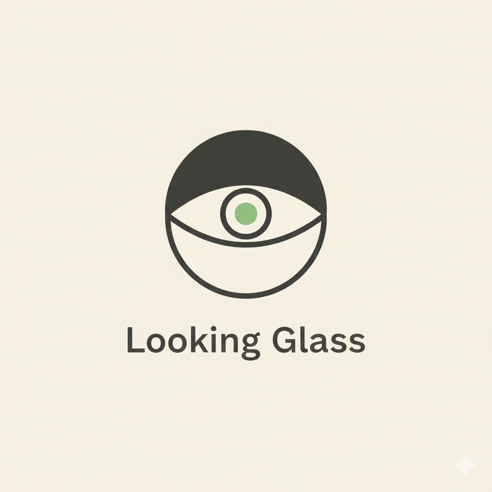

# Looking Glass — AI Journal Reflection Companion

*See your thoughts more clearly.*

Authors: Hanxi Guo & Lindsey Lee  
Course: COMM4190 Final Project

---

## Branding 
- Logo: 
- Slogan: See your thoughts more clearly. 
- One-liner: AI-powered journaling reflections that surface mood shifts, themes, and next-step prompts.

---

## Project Overview
Looking Glass is an intelligent journal analysis tool that guides user reflection with LLM-powered insights. It reads journal entries, surfaces tone/emotion/topic shifts, and offers tailored prompts to deepen self-reflection over time.

### Key Capabilities
- Identify tones, emotions, and recurring themes per entry
- Track how entries evolve across time
- Provide personalized follow-up prompts and reflection guidance
- Offer sample datasets for quick experimentation

### Tech Stack & LLM Usage
| Area | What we use | Purpose |
| --- | --- | --- |
| LLM prompting | Notebook-driven prompts (provider-agnostic) | Extract tone/emotion/themes; generate reflection prompts |
| Workflow design | Milestone 5 notebooks (prompt chaining steps) | Outline end-to-end reflection flow and decision points |
| Data inputs | Journaling text; CSV prompt tests; sample files (`sample_data/`, `sample_journals/`, `sample_writing/`) | Evaluate prompts across diverse tones, safety cases, and creative inputs |
| Evaluation | Prompt testing CSVs in `Milestone3_usage_scenarios/` | Compare prompt iterations and outputs |

---

## Repository Map
- Pitches: initial concepts
  - [Lindsey Lee Pitch](./01_lindsey_lee_pitch.ipynb)  
  - [Hanxi Guo Pitch](./01_hanxi_guo_pitch.ipynb)
- Brand development
  - [Looking Glass Brand Development Notebook](./01_brand_development.ipynb)
  - [Looking Glass Logo](./looking_glass_logo.png) 
- Usage scenarios (design): milestone planning notebooks  
  - [Lindsey Lee Usage Scenarios](./02_LL_Milestone_#2-Usage_Scenarios.ipynb)  
  - [Hanxi Guo Usage Scenarios](./02_HG_Milestone_#2_Usage_Scenarios.ipynb)
- Usage scenarios (implementation & testing): [`Milestone3_usage_scenarios/`](./Milestone3_usage_scenarios/) — notebooks, prompt tests, and sample data
- App workflow development & testing: [`Milestone_5/`](./Milestone_5/) — workflow notebooks and supporting data
- Prompt reference: [original_prompt.md](./original_prompt.md)

---

## How to Navigate
1. Skim the pitches and brand development notebooks to see concept evolution.
3. Read usage-scenario notebooks (`Milestone3_usage_scenarios/`) for concrete flows and prompt testing.  
4. Explore workflow builds in `Milestone_5/` to see how prompts and data are orchestrated.  
5. Experiment with sample journals and data (`Milestone3_usage_scenarios/sample_journals/`, `sample_data/`, `sample_writing/`).

---

## Data & Notebooks
- Notebook formats: Jupyter (`.ipynb`)—open directly in your IDE or Colab.
- Sample data lives alongside each milestone folder for quick runs.
- No code execution is required to understand the project; notebooks contain outputs and annotations.

---

## Contact

For questions or suggestions, please contact the project team members.
